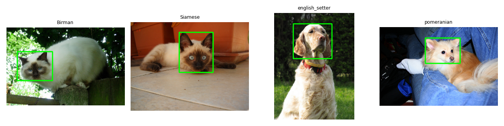
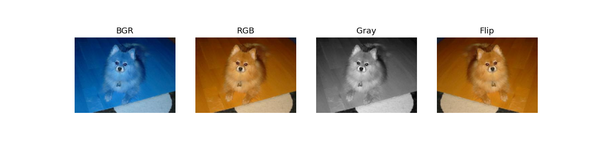

# Лабораторная N: название

**Вариант:** 7

## 1. Задача

Настроить среду, загрузить данные своего варианта, научиться читать изображение как массив numpy и собрать сводку по датасету: размеры, форматы, режимы, разметка.

## 2. Как запустить

Запускал в Google Colab. Открыьб `solution.ipynb` в Colab, в первой ячейке вписать `VARIANT = 7` и выполнить Run All. Данные скачиваются первой ячейкой, GPU не нужен.

```bash
pip install -r requirements.txt
# откройте solution.ipynb, впишите VARIANT = 7 и выполните Run All
```

## 3. Данные

Вариант 7, четыре породы: "Birman", "Siamese", "english_setter", "pomeranian". Битые файлы и дубликаты не удалял, все 807 изображений использованы.

## 4. Результаты

| Что                        |        Значение |
| -------------------------- | --------------: |
| Файлов                     |             807 |
| Пород                      |               4 |
| Кошек / собак              |       404 / 403 |
| Ширина min / медиана / max | 183 / 500 / 679 |
| Высота min / медиана / max | 150 / 375 / 798 |
| Не в RGB                   |               0 |
| `.jpg`, не являющихся JPEG |               0 |
| С XML-боксом головы        |             405 |





## 5. Выводы

- Все 807 файлов в режиме RGB, и «чужих» расширений нет (0 из 807). OpenCV по умолчанию отдаёт 3 канала, и для этого варианта проверка через Pillow ничего не нашла, так что обучение на этих файлах не сломается из-за формата.
- Классы по виду почти ровно поделены: 404 кошки и 403 собаки, перекоса нет, accuracy на таком наборе не будет завышена за счёт большого класса.
- Размеры сильно разные: ширина от 183 до 679, высота от 150 до 798 при медианном кадре 500×375. `cv2.resize(img, (224, 224))` у типичного кадра меняет пропорции в 1,33 раза, у самых вытянутых фото искажение больше.
- Бокс головы есть только у 405 из 807 изображений (50,2%). Для задач с боксами в следующих лабах придётся брать только эту половину.
- Значение центрального пикселя: [82 158 217] в BGR и [217 158 82] в RGB. Без `cvtColor` matplotlib трактует каналы как RGB, поэтому красный и синий меняются местами и цвета на картинке искажены.
